# Promptflow UX audit and recommendations

Audit dates: November 10–11, 2026. Frontend: `C:\missinglink-frontend\frontend\MissingLink`; backend: `C:\missinglink-backend\src`. Live application: <https://missinglink.build/promptflow>. The supplied `.buld` address did not resolve.

**The earlier November 11 release was deployed and verified below. The newer adaptive-run, nested-process, cost-control and documentation changes (PF-058–070) are local and have not been deployed.** Per-issue “Fixed locally” labels describe the validation originally performed, not a claim that every fix has been retested in production. The audit used the user's signed-in Chrome session, anonymous browsing, source inspection, and an isolated localhost server with synthetic data. Existing unrelated repository changes were preserved. This is a feature walkthrough and targeted repair, not a claim that every provider, payment, or production lifecycle passed end-to-end.

Evidence terms: **Live** = reproduced in the deployed UI; **Source** = traced in implementation; **Local** = verified using the modified page with synthetic API responses; **Recommendation** = proposed improvement, not necessarily a functional failure. P1 means high priority because money, trust, access, or a primary workflow is affected; P2 is a substantial usability problem; P3 is polish.

## The fal.ai charge in the supplied screenshot

The screenshot is consistent with two concrete defects:

1. The old `computeCost()` chose an LTX video price when a plan had an absent or unknown model, even when its actual steps were search and Claude. The UI then unconditionally printed a fal.ai row. A stale top-level video model could also override the meaning of a saved process's steps.
2. The planning route separately added rough per-step charges that were not shared by the execution calculation. The displayed quote and recomputed charge could therefore disagree.

The local implementation uses actual steps as the pricing source, skips non-fal recipes when calculating fal costs, prices recognized fal steps individually, and shares the same calculation between planning and execution. It labels provider amounts as **estimates**. Unknown providers, external APIs, loops, and unresolved nested processes disclose their estimate limitations instead of inheriting a video price.

For old records, the UI preserves the recorded total but hides the unreliable provider breakdown and explains why. It does **not** rewrite transaction history or claim that old totals have been reconciled. The screenshot's 1,260 tokens / $0.6300 needs a separate ledger review against actual execution and refunds; this audit cannot establish an exact refund amount from the screen alone.

The completed history card now says Completed and previews same-origin plain text inline. These corrected views use synthetic data, including the historical total from the screenshot; they are not a new production charge.

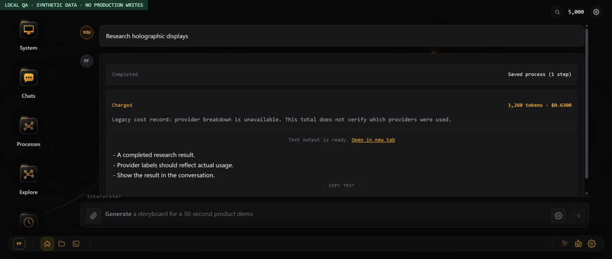

[Mobile verification image](promptflow-ux-evidence/completed-run-mobile.jpg)

## Findings and repair status

| ID | Priority | Evidence / reproduction | Change or recommendation | Status |
| --- | --- | --- | --- | --- |
| PF-001 | P1 | Live, Source: signed out → Find → open a process shows blocking `not_logged_in`. | Open a meaningful sign-in dialog; retain the selected process for same-page email sign-in. OAuth return-to-process still needs testing. | Fixed locally; dialog verified |
| PF-002 | P1 | Live: signed out → Explore displays a raw authentication error and API-routing instructions. | Route anonymous discovery to the supported public catalog. | Fixed locally; verified |
| PF-003 | P1 | User screenshot, Live, Source: non-fal research process shows a fal charge; missing/unknown model falls back to LTX. | Calculate from actual providers/steps; version cost records; remove quote-only extra step surcharge. See billing explanation above and PF-034. | Fixed locally; regression tests pass; historical reconciliation open |
| PF-004 | P2 | Live, Source: completed Research Paper Web Search history still says Running. | Use persisted status in history; update run-card headings on completion/failure. | Fixed locally; completed and failed states verified |
| PF-005 | P1 | Source: unconfirmed cost card says Charged; run-input estimate is guessed from output kind. | Label pending costs as estimates, use server step-based estimates, and update completed cards from returned charge data. Zero creator fee must not imply free compute. | Fixed locally; tests pass; synthetic quote verified |
| PF-006 | P2 | Live: Generate → empty Generate click silently does nothing. | Persistent inline validation, accessible error association, focus on required input; clear error when typing. | Fixed locally; verified |
| PF-007 | P2 | Live: generation shows a long narrative of model/catalog decisions before the result. | Show concise server-driven stages, elapsed time, connection feedback, Stop, and recoverable errors. Discard streamed internal narrative from the presentation. | Fixed locally for process generation; success, Stop, retry, and failure verified with synthetic streams. Server cancellation remains a follow-up. |
| PF-008 | P2 | Live, Source: filters omit actual catalog types; cards show `MULTI` and internal names such as `STRUCTURED_PACKET`. | Populate filters from actual types, with readable labels. Use a shared display-label mapping for cards, editor, and graph too. | Filters fixed locally; full label consistency open |
| PF-009 | P2 | Source: Find renders only the first 60 results while counting all matches. Published excludes the caller's own published items. | Render all matching results and include owned published items in Published scope; add clear filters. Introduce explicit pagination if catalog scale requires it. | Fixed locally; 65/65 and 31 filtered document items verified |
| PF-010 | P2 | Source: failed library HTTP responses can look like an empty catalog. | Check response status and shape; distinguish empty from unavailable; timeout and Retry. | Fixed locally; synthetic 503 and Retry verified |
| PF-011 | P2 | Live, Source: Agents returns 404 and polls repeatedly; Cron offers a submit flow with no backend route. | Show availability before configuration, stop unavailable-agent polling, and disable scheduler submission. Backend scheduling and agent lifecycle remain unimplemented. | UI fixed locally; unavailable states verified |
| PF-012 | P2 | Live: text output says it is ready but only offers another tab. | Show a bounded, safe text preview with Copy and full-output link. Restrict preview fetches to same-origin plain text/JSON; retain fallback. | Fixed locally; desktop/mobile/copy verified |
| PF-013 | P2 | Source, Local: global scrollbar suppression, unnamed inputs, mouse-only cards, and inconsistent dialog focus behavior. | Restore scroll affordances and focus outline; label composer/search/filter fields; make discovery cards keyboard operable. Audit remaining dialogs, graph nodes, folder cards, and icon names with keyboard and screen reader. | Partial fix; discovery keyboard and 390px result layout verified |
| PF-014 | P3 | Live: sign-in copy talks about animating images in a general process product. | Use task-relevant run/create/save wording. | Fixed locally; verified |
| PF-015 | P1 | Live, Source: generated QA process → Run submits “Run …” as an edit; response says no changes were requested. Two functions with the same name override each other. | Keep one editor Run handler that opens the typed input collector, then explicitly enters execution. | Fixed locally; input collector and regression verified |
| PF-016 | P1 | Local, Source: starting an editor run clears the adopted message bubble, hiding progress/errors. | Keep the run bubble mounted when leaving the editor; remove only the editor pane. | Fixed locally; visible synthetic run failure verified |
| PF-017 | P2 | Live, Source: a private draft displays LIVE AT with a public-looking URL. | Display a public URL only for an eligible published/publicly runnable non-draft process. | Fixed locally; draft/public fixtures verified |
| PF-018 | P2 | Live, Source: text-summary generation chooses `multi`; the planner's allowed output schema omits `text`. | Add text to process output type and planner schema. Backfill existing misclassified processes only after checking actual outputs; remove remaining default-to-video assumptions. | Schema fixed locally; existing metadata cleanup open |
| PF-019 | P1 | Live, Source: Explore search labels candidates anonymous/free/text→video regardless of metadata. | Join search candidates with authorized catalog metadata; show actual creator, creator fee, and output kind. Put recommended results first; collapse ranking diagnostics. | Fixed locally; synthetic paid/multi result verified |
| PF-020 | P1 | Live: Explore Public search includes the private QA process created during this audit. This was the owner's own data; no cross-user disclosure was demonstrated. | Restrict Public discovery results to published/system entries; reconcile backend retrieval scope and product documentation. | Frontend filter fixed locally; backend scope review open |
| PF-021 | P2 | Live: Explore → Chats changes sidebar highlight but leaves Explore covering the page. | Close discovery mode before opening another folder view. | Fixed locally; Chats view verified |
| PF-022 | P2 | Source: `_dPgLoading` drops newer requests; stale responses can overwrite current search. Clearing search retains the last shortlist. Search-on-Enter is undisclosed. | Cancel superseded requests, guard response ordering, restore browse catalog when cleared, disclose Enter behavior, and offer a user-facing Retry state. | Fixed locally; ordering regression and Enter search verified |
| PF-023 | P2 | Live, Source: Chats contains 15 cached conversations; the folder path does not expose the old sidebar's load-more behavior. | Add cursor pagination/load more and total/loading feedback; verify that conversation 16 and older are accessible. | Open |
| PF-024 | P1 | Source; settings UI inspected without reading or submitting keys: Model & API form promises encrypted storage, but `dMaAutoSave`/`dMaSave` serialize keys into localStorage and the generic settings JSON endpoint. | Stop accepting provider keys through generic preferences. Use authenticated encrypted server-side secret storage, write-only inputs, masked saved state, and a migration/removal plan for existing plaintext copies. Do not claim encryption before implementing it. | Hosted key entry disabled locally; generic GET/POST and settings headers strip keys. Existing plaintext copies and encrypted hosted BYOK remain open. |
| PF-025 | P1 | Source: Model & API UI promises model routing/BYOK/no PF tokens. The header sends model/presence metadata, while the inspected Promptflow backend does not consume `X-PF-Settings` or `access_mode` for execution/billing. | Wire and test routing and billing end-to-end, or mark unsupported modes unavailable. Prove selected model/key and resulting charge with a provider stub before enabling. | Model routing fixed locally; hosted BYOK marked unavailable. See PF-060 and cost caveats below. |
| PF-026 | P1 | Source: ranking settings and Model & API settings save different objects into the same endpoint, which replaces the full JSON blob. | Use a versioned shared schema with scoped updates/merge semantics; verify saving one panel preserves unrelated settings. | Server merges existing settings locally; full production cross-panel round trip remains unverified. |
| PF-027 | P2 | Source: Model & API changes auto-save locally even if the user closes/cancels the dialog. | Choose explicit Save/Cancel semantics or indicate immediate saving and provide Undo. Never auto-persist secrets on keystrokes. | Open |
| PF-028 | P2 | Live, Source: a Claude-only generated process imports `fal_client` and `requests`; shared code scaffolding assumes provider setup. | Use the executable manifest and included runtime; derive dependencies from actual steps. Ignore old blanket dependency metadata for built-in-only workflows. | New downloadable runtime fixed locally; text/search export regression passes. Legacy `original.py` remains reference code and may retain stale imports. |
| PF-029 | P2 | Live: suggested compositions join a UX audit digest with a UFO digest and a summary evaluator with a frame-transition evaluator. | Check input/output compatibility and task relevance before presenting “Build something with this”; explain a valid connection or omit the suggestion. | Open recommendation |
| PF-030 | P2 | Live, Source: Explore initially shows four public system processes even though the account has published processes; public graph scope excludes owned items by design. | Decide whether Public means all published or other authors' published entries. Align browse, search, Find, profile, graph, and learning copy with that definition. | Open product/implementation decision |
| PF-031 | P2 | Live, Local, Source: Discard draft and Save to workspace remain visible on non-drafts/read-only processes. CSS `display: inline-flex !important` defeats JS hiding. | Remove the overriding display declaration so draft controls follow ownership and state. | Fixed locally; both controls absent on published read-only fixture |
| PF-032 | P1 | Live, Source: signup promises 1,000 starting tokens, while Learn more advertises 100,000 monthly free tokens. | Establish one entitlement source and make signup, marketing, balance, renewal timing, and subscription text agree. Verify real entitlement before changing numbers. | Open |
| PF-033 | P2 | Live: editor fills with composition suggestions and code before a simple run-oriented workflow; generate wording can become “Generate a process that Create a process …”. | Lead with process state, readable inputs/output, Run, Edit with instructions, and Save. Collapse steps, code, composition ideas, and secondary actions. Preserve direct generation wording. | Fixed locally; desktop/mobile, Run input focus, refinement, save confirmation, and published read-only controls verified. |
| PF-034 | P1 | Source: pricing is still estimated; external APIs, loops, and unresolved nested processes are incomplete. Failed/canceled/auto-retried jobs need ledger-level reconciliation. | Build an execution usage ledger with per-step provider, model, quantity, creator fee, actual charged/refunded amounts, and retry linkage. Audit historical LTX fallback charges; define refund policy from evidence. | Open; limitations now disclosed |
| PF-035 | P2 | Live: Contribute's “APIs already connected” list looks disconnected despite platform-funded token mode being usable. | Distinguish platform access, user-owned credentials, missing required secrets, and optional integrations. Validate only dependencies required by the submitted process. | Open recommendation |
| PF-036 | P2 | Live: saved preferences can show opaque process IDs for missing/renamed processes. | Keep a display-name snapshot and explicit “process unavailable” state with a remove action; reconcile deleted references. | Open |
| PF-037 | P2 | Live: schedule preview provides clock times and cron expression without a clear timezone. | Before scheduling ships, display timezone, next execution time, daylight-saving behavior, estimated cost, and pause/delete controls. | Open recommendation; submission disabled locally |
| PF-038 | P2 | Live: QA draft loses its draft label after accidental refinement. CSS explains lingering draft buttons but does not prove the underlying saved state. | Preserve loaded draft/ownership fields in the refine response and merge updated fields into the editor. | Fixed locally for refinement; synthetic browser edit retains Draft. Production reload/commit lifecycle still needs staging verification. |
| PF-039 | P1 | Local, Source: opening a conversation from an editor clears the pane but retains the previous process's refine binding and Done editing control. | Clear process refinement state when loading a different conversation so the next message cannot edit an unrelated process. | Fixed locally; regression and browser transition verified |
| PF-040 | P2 | Local, Source: rotating example prompts overwrite the editor's change instructions and suggest unrelated actions while messages would refine the open process. | Keep the composer labelled Edit process, retain the current process name, and suppress rotating examples outside a new conversation. Guard delayed animation callbacks too. | Fixed locally; browser and delayed-callback regression verified |
| PF-041 | P1 | User, Source: settings instruct users to install a nonexistent PyPI interpreter; advertised local-file `run` accepted only a server ID. | Download the CLI ZIP, extract, install its source in a venv, and dispatch local file/folder arguments without account login. | Fixed locally; ZIP installation and installed-CLI execution verified. |
| PF-042 | P1 | Source: old web export depends on nonexistent `promptflow_sdk`, prints a resolved graph containing secrets, then returns success without executing. | Embed a real runner, validate setup before calls, execute actual steps, redact credentials in returned JSON, and fail with nonzero status. | Fixed locally; direct Python execution, missing inputs/keys/packages, invalid JSON, and secret-redaction tests pass. Custom author code remains responsible for its own side effects and logging. |
| PF-043 | P2 | Source: local runner buffers output until completion; editor refinement waits on non-streaming HTTP; CLI streams expose internal narrative and parse SSE one line at a time. | Stream public activity summaries and elapsed-time updates, use proper SSE frames, stop at terminal events, and never automatically replay interrupted paid work. | Fixed locally; CLI frame/EOF tests and browser refinement activity/completion verified. Server job cancellation remains open. |
| PF-044 | P1 | Source: browser and CLI exports synthesize different files; nested processes and custom dependencies can be absent. | Use a shared bundle builder, recursively package accessible children and their custom modules/requirements, namespace loop prompts, and report unavailable implementations. | Fixed locally; direct archive, extracted folder, nested process, requirements, loop prompt, and installed CLI tests pass. |
| PF-045 | P2 | Source: code viewer recreates an approximation of the download, including unused provider dependencies. | Load the actual bundle JSON; show loading/error/retry instead of fabricated files; explain reference Python versus executable manifest. | Fixed locally; metadata save invalidates the bundle preview. Full manual code-edit round trip remains a staging check. |
| PF-046 | P1 | Live, Source: opening Run for a generated text-only lesson inferred image, video and audio from unused reference-Python placeholders, silently persisted those requirements, and execution rejected the missing image before charging. | Infer missing inputs from executable steps, using Python only for legacy processes without a graph. Do not infer requirements from sample data. Repair affected process metadata separately. | Fixed locally with regression coverage; not deployed. Existing corrupted metadata is not automatically removed because declared inputs may be intentional. |
| PF-047 | P1 | Live logs, Source: public process template rendering throws `.active is not a function`; unescaped backticks in a comment terminate the outer HTML template literal. | Remove the nested delimiters and execute the actual template builder in a regression test, then parse its generated scripts. | Fixed locally; template and bundle tests pass. Not deployed. |
| PF-048 | P2 | Live: insufficient platform Anthropic credit appears as raw provider JSON, despite a healthy PromptFlow token balance; an earlier attempt showed only a network error. | Explain provider-account availability separately from user tokens; retain diagnostic detail behind an expandable control. | Open. Generation succeeded after the user updated the provider setup. |
| PF-049 | P1 | Live: existing “GPT Image 2 Generator” claims image output but its step list contains only an AI text step. | Validate advertised capabilities and output type against the executable graph before saving/publishing; flag old mismatches for repair. | Open. Existing process inspected only, not changed. |
| PF-050 | P2 | Live: the six-step draft initially shows reference Python importing fal and routing OpenAI/document recipes through fal. This contradicts the actual graph and the executable bundle. | Label reference code explicitly, make the actual downloadable runner the primary view, and retire incorrect legacy synthesis. | Open follow-up to PF-045; misleading default Python view remains. |
| PF-051 | P1 | Live, Source: the run displayed `plan_already_used` as “Run failed” while D1 showed the same plan executing and its first OpenAI image completed. | Recover the same plan through status polling; do not replay execution on lost responses, duplicate-claim responses, or unknown status. | Deployed; a fresh live six-step run continued through polling and reached completed output. The source of the original duplicate request remains unconfirmed. |
| PF-052 | P1 | Live, Source: multi-step HTTP execution remained on “Starting…” with no step progress; the second image remained `running` long after the UI stopped watching. | Keep active execution responses alive, display read-only per-step activity concurrently, and implement durable execution leases/checkpoints plus orphan reconciliation. | Streaming keepalive and activity observer deployed; live OpenAI step 3, step 4 and text review step 5 observed, then completed document. Durable background execution and settlement of the earlier stranded job remain open. Keepalive alone does not guarantee completion after a disconnected client. |
| PF-053 | P2 | Live: token header stayed at 158,985 after 60 tokens were deducted; reloaded conversation said Running but did not resume live progress. | Refresh authoritative balance on accepted execution and recovery, and reconnect history to active jobs without resubmission. | Open for in-progress/reloaded jobs. The successful follow-up did refresh its final balance correctly to 158,865. |
| PF-054 | P2 | Live: document figures are automatically numbered 2 and 8 using section positions, while authored captions say Figure 1 and Figure 2. | Count only actual figures; use one caption source and consistent numbering. | Open recommendation; found in the completed lesson document. |
| PF-055 | P2 | Live: source citations appear as raw `[title](URL)` text, with no clickable links; numbered steps and answers are paragraphs rather than semantic lists. | Render safe Markdown links and ordered lists in document assembly; preserve equivalent behavior in the local interpreter. | Open recommendation; the URLs are visible but require copying manually. |
| PF-056 | P3 | Live: recovery shows two elapsed timers with different start times; after completion the original rationale still says “Running …”. | Use one execution clock and replace the running rationale with a completion summary. | Open recommendation. |
| PF-057 | P2 | Live, Source: “Download PDF” points to the HTML document with `?print=1`, a browser-print flow rather than a PDF file download. | Label it “Print / Save as PDF”, or provide an actual PDF artifact. | Open recommendation; a PDF file was not generated or verified during this run. |
| PF-058 | P1 | User, Source: “run it but generate synthetic input data first” is treated as literal workflow data or an editor change. | Separate input data from run instructions, plan preparation using available text/search/media tools, preserve the exact selected workflow, name the run, and require review before execution. | Fixed locally in UI, hosted planner, and CLI 0.3.0; controlled preparation and browser review tests pass. Live planner quality still needs post-deploy validation. |
| PF-059 | P1 | User screenshot, Live inspection, Source: Web-Sourced Labeled Set → Tuned Search Policy fails with `sub_process_fal_recipe_unsupported` on nested `report_document`. | Expand accessible nested processes before pricing; dispatch document/HTTP/value steps through their actual implementations; preserve typed input mappings and loop outputs across queued media/resumption. | Fixed locally; named nested-document regression, typed loops, serialization and bundle tests pass. The actual live workflow has not been rerun with these changes. |
| PF-060 | P1 | Source: model preferences are saved but ignored by runtime calls; settings advertise text providers unsupported by the runtime. | Apply request-local activity choices, freeze text models into reviewed plans, offer per-run overrides, and expose only supported text-provider choices. | Fixed locally; request isolation, model/output-limit tests and browser settings checks pass. Selected models still require platform provider access. |
| PF-061 | P1 | User, Live inspection, Source: a collection loop performs search and labeling per product with little control over repeated calls; direct saved runs quote an unused planning fee. | Add Economy/Balanced presets, output limits, a per-loop item limit, and a compute-credit cap checked before charging. Remove the planning fee for direct runs that skip planning. Explain credits versus provider tokens and incomplete provider accounting. | Fixed locally for these controls; real usage ledger, provider-dollar cap, cumulative nested-loop budget and model-based credit pricing remain recommendations. |
| PF-062 | P2 | Local browser: review → Edit process removes the review but fails to reopen the editor because `pickedId`/`pickedProc` are out of scope. | Retain the selected process binding in the review handler's shared scope. | Fixed locally; review → correct editor verified in Chrome. |
| PF-063 | P2 | Local browser: an over-budget preparation failure's retry restores only the chat text, losing the workflow binding and run options. | Reopen the exact workflow's run form with its name, instructions, input data, selected model and cap; retain attached files in memory for retry. | Fixed locally; budget refusal/recovery verified below. Attachment retention implemented but not browser-tested with a real file. |
| PF-064 | P1 | Live, Source: after the failed search-policy run, `genreate` produces Brave image search paired with LTX video controls and asks for an image. The planner falls back to a model from catalog order; the default parameter form assumes video. | Clarify vague commands before planning; remove arbitrary recipe/model fallbacks; execute single built-in tools through their real step implementation; suppress video fields on legacy built-in-tool cards. | Fixed locally; exact typo verified in Chrome; built-in-target and ambiguous-command regressions pass. Existing failed records remain historical. |
| PF-065 | P1 | User, Source: opening an editable process or retaining a refinement binding sends almost every message to `/process/refine`, including questions and unrelated requests. A conversation ID alone also activates planner refinement context. | Treat the selected workflow as context. Discuss questions without mutations, route explicit runs to review, require a specific edit command for refinement, and ask about ambiguous commands. Retain workflow context across history reloads and send authorized graph context to discussion. | Fixed locally; question, explicit edit, typo in loaded history, and run-preparation routes verified with synthetic Chrome responses. |
| PF-066 | P1 | User screenshot, Source: “generate the test data” enters the full authoring prompt and returns update_process, then the run guard rejects it. | Use dedicated input preparation, keep the exact selected workflow immutable, and append its call on the server. Let delegated test-run requests select an available process. | Fixed locally. Exact forced and unselected run requests tested; general web/media preparation validated with provider fixtures. |
| PF-067 | P2 | User, Source: hidden desktop hero still schedules SVG mutation work; each opened graph registers permanent window mousemove/mouseup listeners. Blurred dock/tooltips and unrestricted transitions add rendering work. | Skip hidden/reduced-motion animation, scope drag events with pointer capture, remove frequent chrome blur and restrict animated properties. | Fixed locally with behavioral tests. No hardware frame-time benchmark or claim that every cause of live hover lag is resolved. |
| PF-068 | P2 | User, Source: an active conversation has no visible name; generic runs often get the title “Workflow run.” | Reuse the automatically generated task/run name, show it in the existing top gutter and browser tab, restore saved names and preserve manual renames. No extra naming model call. | Fixed locally; create, history load, title clearing and rename behavior tested. Existing chat titles are preserved. |
| PF-069 | P1 | Live console: “busy stuck >timeout” warning while Planning remains visible and the composer has silently unlocked. Source: ordinary /plan has no deadline; watchdog clears busy without aborting; backend stream ignores message_stop/error. | Abort the exact timed-out planning request, show a terminal error and retry action, stream generic run progress, stop provider reads on completion/error and bound preparation calls. | Fixed locally; hanging-connection UI fixture, retry, terminal-event and interrupted-provider tests pass. The observed production request was not replayed. |
| PF-070 | P2 | Source: Learn More presents a YAML-style file rather than the executable ZIP format, omits nested files and source installation, and conflates local and hosted billing. Local: the mobile wordmark overflows the viewport. | Explain the actual manifest, prompts, runtime, recipes and child processes; add download-based setup, preparation, editing and billing guidance; fit the mobile title. | Fixed locally; documentation examples pass archive/CLI/extracted preflight checks, links and JSON validate, desktop/mobile guide and disclosures verified in Chrome. |


## Coverage and limits

| Surface | Actually exercised | Outcome / remaining validation |
| --- | --- | --- |
| Entry and authentication | Supplied URL; canonical URL; anonymous and existing Chrome session; anonymous process opening | Canonical app works. Local sign-in dialog works. No new account, password reset, or full OAuth/email sign-in performed. |
| Find | Public list, open process; local 65-item library, text search, no matches, Published + Document filters, clear filters, failed load, Retry | Local fixes verified. Very large catalogs and all sort ties remain untested. |
| Explore | Live browse and semantic research search; local Enter search, private-result exclusion, fee/type metadata, keyboard opening, leaving for Chats | Local fixes verified. Search quality and backend scope remain recommendations. |
| Generate | Live blank submission and one text-summary generation; local inline validation, successful generation, slow stream, Stop, retry, and server error | Created `UX Audit Text Summary` (`b93944aa-eb34-49`) during the initial live audit. It remains unpublished in the account. Follow-up progress testing used synthetic localhost data only. Incomplete and unclosed streams are covered by regression tests. |
| Editor / refine | Live generated process, accidental refinement through broken Run, steps/code/bundle tabs and suggestions; local redesigned draft/public layouts, input focus, refinement, commit confirmation, Close editor, and mobile layout | Local save retains the editor and changes Draft to Private process. Manual code saves, fork/adapt correctness, backend draft metadata preservation, discard, and production deletion are not marked passed. |
| Run | Local input collector, blank-input validation, populated submission, server step-based estimate, synthetic 503 failure | No paid provider execution submitted. Full success/refund/retry/stop flows need controlled backend staging. |
| History / outputs | Live Research Paper Web Search history; local completed legacy-cost turn, inline text and Copy | Local completed state and preview verified. Remote-text fallback, large-output truncation, expired URLs, and image/video/audio/3D playback need dedicated fixtures. |
| Files and export | Live `.py`/`.promptflow` inspection; local CLI ZIP install; production bundle builder exports run directly, extracted, nested, and through installed CLI | Earlier live download remains at `C:\Users\tyler\Documents\UX_Audit_Text_Summary.promptflow`. New synthetic exports execute with the shared runtime. Import round trip and all live provider models remain untested. |
| Contribute | Live form fields and blank Run & demonstrate validation | Required description caught. No personal files, credentials, contribution publish, or execution submitted. Attachments/extraction need a staged non-sensitive fixture. |
| Preferences | Live generation preferences, saved preferences, ranking controls and presets inspected | No persistent account preferences changed. Missing-name issue recorded; backend behavior of all ranking settings not proven. |
| Model & API | Live form inspected, source paths traced | No key values read/submitted. Storage/routing/save semantics remain P1/P2 issues. |
| Secrets | Live list and blank Save validation | Empty-name validation works. No secret created, viewed, modified, or deleted. |
| Recipes | Live panel and blank draft validation | Required capability description caught. Custom recipe generation, installation, execution, and deletion untested. |
| Agents | Live unavailable service and local 404 state | Local coming-soon message and paused automatic refresh verified. Real agent lifecycle unavailable. Sidebar and dock access should be unified. |
| Cron | Live scheduler form; local unavailable disclosure and disabled submit | No trigger created or email sent. Preview is not scheduler functionality. |
| Process map / profile | Live profile stats, private map, Public and High trust controls | Private map rendered 73 processes/43 compositions; High trust yielded an empty state. No graph query mutation, node editing, or exhaustive layout/zoom tests. |
| Terminal | Live Python initialization and `print(1 + 1)` | Returned 2. File/network/GPU/provider execution not attempted. |
| Learn / billing | Live learning and allowance copy; account balance and key/CLI surfaces inspected | Conflicting allowance documented. Checkout, purchases, subscription changes, credential creation/revoke and CLI auth not performed. |
| Responsive / accessibility | Local 390×844 completed-result and editor views, desktop, discovery keyboard Enter, input names, copy, native editor disclosures | Result and editor wrap without document horizontal overflow. Viewport override reset. Full mobile navigation/modal and assistive-technology audit remains. |

No purchases, subscription changes, production deletions, new credentials, publication, or email delivery were performed. The intentional production write was the named QA process; the broken Run control also sent a refinement for that same QA process. A generated bundle was downloaded. These are recorded to make cleanup possible without touching unrelated user data.

## Verification and reproduction

The local preview never forwards requests to production. Start it from the frontend root:

```powershell
node scripts/promptflow-preview.mjs
```

Open `http://127.0.0.1:4173/promptflow`; `?guest=1` simulates signed out, and `?library_error=1` simulates a failing catalog. Generation fixtures also support `?generation_slow=1`, `?generation_error=1`, and `?generation_disconnect=1`. Execution intentionally returns 503. Fixtures test UI behavior, not Cloudflare bindings, production authentication, provider charges, or secret security. Stop with Ctrl+C after testing.

Automated checks:

```powershell
# Frontend root
node --test scripts/promptflow-ux.test.mjs
git diff --check -- promptflow.html

# Backend root
node --test src/promptflow_cost.test.mjs
wrangler deploy --dry-run --outdir tmp/promptflow-ux-build
```

Latest frontend result: **13 tests passed**; frontend whitespace checks passed. Tests cover inline-script parsing, quote/charge lifecycle, legacy totals without false provider attribution, escaped notes, the single editor Run handler, stale search responses, conversation refinement isolation, chunked/multiline generation events, hidden internal narrative, interrupted/error/unclosed streams, and delayed composer animations. The initial audit also passed **8 backend tests** and a Wrangler dry-run; the editor/progress follow-up does not change the backend. Backend tests exercise production pricing logic for stale/missing models, search + Claude, Claude-only, actual fal steps, mixed plans, flat prices, and loop/nested-process disclosure. Pricing tests isolate the function from Cloudflare bindings; they do not prove ledger correctness. No deployment was performed. The temporary QA server was stopped after verification.

Implementation locations: frontend `promptflow.html` (`renderCost`, `renderHistoricalTurn`, `renderSingleText`, `runProcessFromEditor`, `loadConversation`, `pfOpenFindPage`, and `dPgFetch`); backend `src/promptflow_core.ts` (`computeCost` and process types), `src/promptflow_routes.ts` (quote/execution consistency and process quote estimate), and `src/promptflow_planner.ts` (text output schema).

## Editor and generation follow-up — November 10, 2026

The editor now starts with process state, a readable title, input/output cards, and explicit Run, Edit, and Save actions. Steps, code/files, optional composition ideas, and secondary actions are collapsed. Code and composition suggestions load only when opened. Run focuses the input collector; successful draft saving keeps the editor open with a confirmation. Editing instructions stay stable in the composer.

Generation uses server signals for stages and displays elapsed time and connection status without invented percentages or model deliberation. Terminal success/error events end the wait even when the connection stays open; an interrupted stream is a failure rather than a false success. Failed or stopped generation offers a way to restore and edit the request. The request has a finite timeout.

Remaining recommendations from November 10: add an explicit backend job-cancellation contract and draft reconciliation before automatically retrying. Stopping currently aborts the browser request; the server may still finish a draft, and the UI says to check Processes. The November 11 work below adds discussion activity summaries and preserves refine metadata. Composition relevance (PF-029), production lifecycle validation, and paid execution still need staging validation.

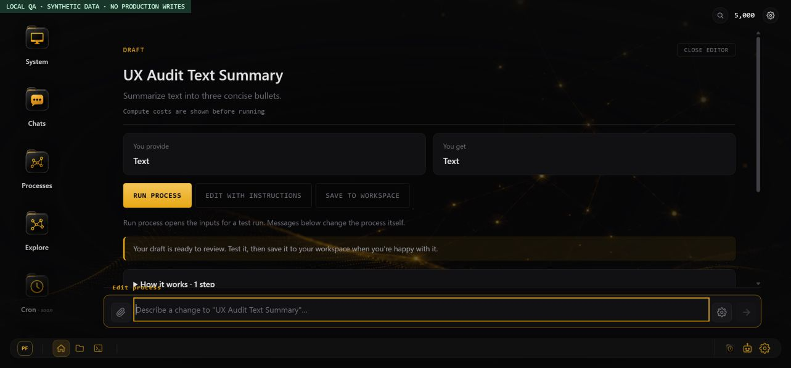

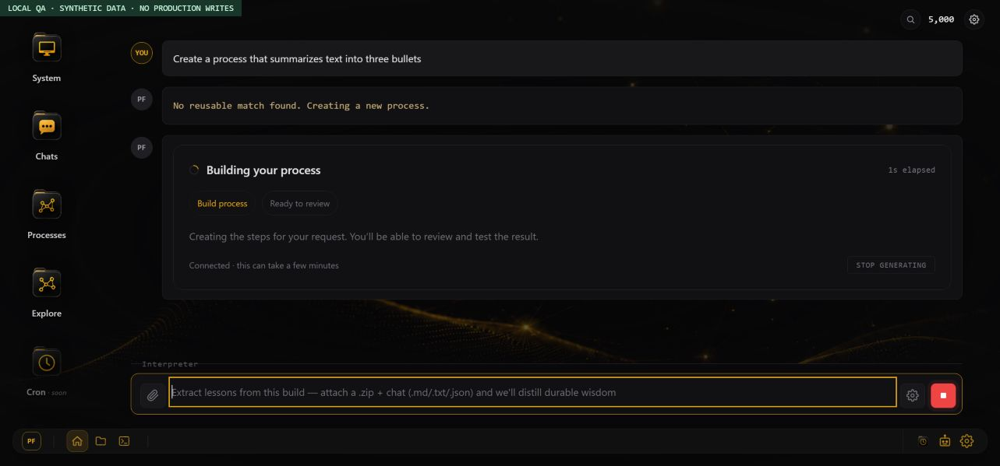

[Updated editor at 390×844](promptflow-ux-evidence/editor-mobile-local.jpg)

## Downloadable interpreter and activity follow-up — November 11, 2026

Agents, Cron, and the other unfinished features are intentionally deferred at the user's request.

The maintained interpreter is now the versioned `promptflow-cli/` source and its rebuilt `promptflow-cli.zip` (0.2.0). Settings and the download page instruct users to extract the ZIP, create a Python environment, and install the local folder. No nonexistent PyPI interpreter or SDK is required. [Installation and usage](../promptflow-cli/README.md) covers Windows, macOS/Linux, provider credentials, preflight, input files, output folders, direct Python execution, and online login.

New `.promptflow` downloads contain the same runtime as the CLI. The executable manifest supports text/JSON analysis, Brave search, OpenAI image generation, recognized fal media, HTML documents, loops, accessible nested processes, and bundled custom recipes. Both export routes use the shared builder. Only actual fal steps require fal-client; custom modules retain their declared packages. Old reference Python is not executed by the new runner. Unsupported steps, missing nested processes, missing inputs/keys/packages, and malformed JSON fail explicitly instead of printing a plan and claiming success. Provider requests are not automatically replayed.

Progress describes public work as it happens: reading inputs, finding reusable processes, designing steps, considering edits, checking structure, saving, searching sources, composing a response, or assembling output. Browser generation/refinement and CLI online authoring consume server stages; local execution emits per-step start/completion and ten-second elapsed-time updates. Raw internal model narrative is not shown. JSON output and saved artifacts are separate from terminal progress. Browser refinement was verified on synthetic localhost data, including an in-progress activity message and a completed edit that retained Draft state.

Verification on November 11:

- 13 frontend regression tests passed, including streamed event parsing and interrupted/unclosed connections.
- 13 Python runtime/progress tests passed using controlled responses: search → summary, typed loops, malformed JSON stopping later calls, secret redaction, unsafe ZIP paths, missing packages/media, file-URL media uploads, document artifacts, and multiline/terminal SSE handling.
- 9 backend export tests passed against the production bundle builder, including direct Python execution, extracted folders, nested processes, custom requirements, loop prompt names, provider endpoint mapping, and running an exported archive through the installed CLI with an isolated account configuration.
- 8 existing pricing regression tests passed. Wrangler's deploy dry-run passed; no deployment occurred.
- The source ZIP installed successfully into an isolated Python 3.9 environment. No paid provider calls or production writes were made in this follow-up.
- Browser checks also confirmed the exact-bundle preview's unavailable state, Retry control, disabled Copy during failure, and recovery to reference Python. Settings keyboard focus can leave the modal; this remains part of PF-013's dialog accessibility follow-up.

Reproduce the additional checks:

```powershell
# Frontend root: rebuild both delivery artifacts from one runtime source
python scripts/build-promptflow-cli.py --backend C:/missinglink-backend
python -m unittest discover -s promptflow-cli/tests -v

# Backend root: point to a CLI installed from the ZIP to include the install test
$env:PROMPTFLOW_TEST_CLI = 'C:\path\to\venv\Scripts\promptflow.exe'
node --test src/promptflow_bundle.test.mjs src/promptflow_cost.test.mjs
```

The Python suite needs the CLI's normal dependencies installed. Provider contract tests use controlled responses; live credentials, current model access, every media model, custom third-party libraries, CLI browser login, and production create/refine/reload/commit flows are not certified by these checks. `--check` checks setup, not key validity or model access. Custom author code can perform its own logging and side effects. The unrelated YAML interpreter and continuation-lab format were left unchanged. Release the rebuilt ZIP and frontend together with the backend runtime/stream routes; downloading again is necessary for old exports missing executable steps.

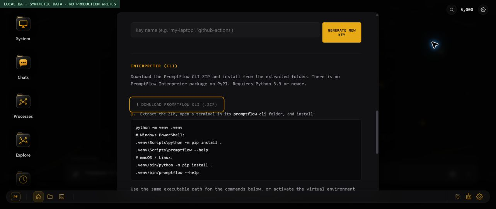

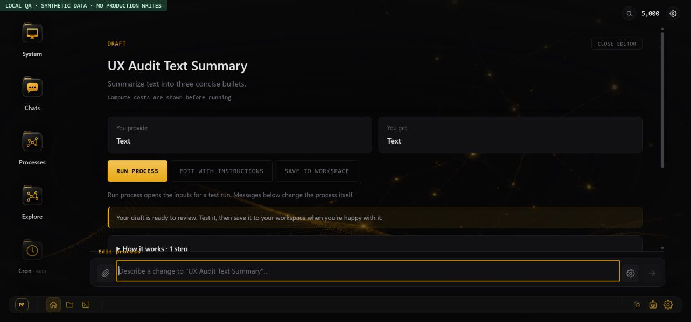

## Live release verification — November 11, 2026

After the user reported deployment complete, read-only checks confirmed:

- Cloudflare lists backend deployment `f1c6ca96-4e6a-4981-9dd3-769b0e7edd57` at 15:46:29 UTC (10:46:29 AM Eastern), serving 100% of traffic for `missinglink-backend`.
- The signed-in live frontend Settings panel shows ZIP/source installation, Python 3.9+, `--check`, provider credentials, and the statement that no PyPI interpreter package exists.
- GitHub `main` serves the CLI ZIP with Git blob SHA `c54f681c12cf35f4bdf67c9ecf4e4f1d24cfa00c`, exactly matching the rebuilt local ZIP.
- A fresh browser download of the existing QA process contains manifest runtime version 0.2.0, a Python entry point, and `_promptflow_runtime.py` identical to the maintained runtime source. Its only step is Claude, and its requirements file contains no fal dependency.
- The installed CLI accepts that production export and, with no Anthropic key supplied, exits with a clear missing-`ANTHROPIC_API_KEY` preflight message. No provider execution was requested.

The fresh download is at `C:\Users\tyler\Documents\UX_Audit_Text_Summary.promptflow`. No new process, edit, paid run, credential, or deployment was created during these release checks. Live generation/refinement streaming and paid-provider execution were not exercised here; the earlier controlled tests remain the evidence for those paths.

## Complex live image workflow — November 11, 2026

User authorized a maximum of 5,000 PromptFlow tokens. The created process, **Research-to-Visual Lesson Pack** (`f36cf172-943d-40`), has six executable steps: Brave search, Claude lesson drafting, OpenAI overview illustration, OpenAI worked-example illustration, Claude text review, and HTML document assembly. It was saved as a private workspace process; the Saved to workspace receipt and all six steps were verified. The test topic is urban heat islands for ages 13–15, with a quiz, answers, sources and two complementary diagrams. The first run was rejected before charging because of PF-046. Live refinement corrected the input metadata and removed unused reference-code placeholders; its activity messages and completion were observed.

Run `eb674dc1-648c-42` started at 16:18:33 UTC. Search and text drafting completed, followed by a 1024×1024 OpenAI overview image. The second image started at 16:19:29 UTC and remained `running` in subsequent checks, with no final document or failure recorded. The frontend incorrectly reported failure with `plan_already_used`; reopening the conversation showed Running. This is **partial execution, not an end-to-end pass**. No repeat paid execution, forced database state change, refund, publication or deployment was performed. The server record and account balance confirm 60 tokens deducted (158,985 → 158,925), below the authorized cap. The displayed estimate excludes external API usage and is not a complete provider-cost accounting.

[First generated OpenAI overview image](https://missinglink.build/api/promptflow/image/ecf45a43-1f7c-4c50-a62e-ce1f88ae9e60.png) was opened and visually inspected. Its large labels cover sunlight, heat storage, tree cooling, shade and reflection. Teacher review should clarify the shade region and distinguish stored heat from the upward heat-release arrows; the text-review step does not visually validate figures.

Final read-only server check at **16:28:12 UTC** still showed the same second image running, no error, and no final document. No claim is made that the worker is still actively processing rather than stranded; the stored status cannot distinguish those cases.

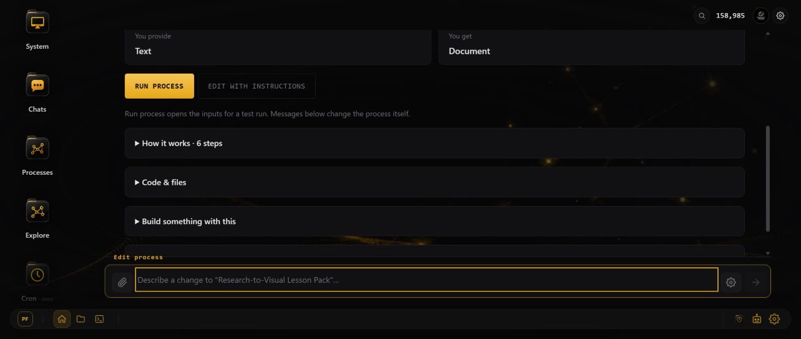

Local repairs from this test:

- Executable-graph input inference ignores unused Python scaffolding and sample data; intentional declared inputs remain preserved.
- Public process HTML template renders without the nested-backtick runtime error.
- `/execute/stream` sends headers and heartbeats while the existing authenticated execution route runs once. The UI reads its terminal result and observes `/status/steps` concurrently.
- A duplicate-claim or lost execution response leads to polling the same plan. An unknown status or polling timeout does not trigger a new paid retry.

Validation: **18 frontend tests and 11 backend bundle/stream/template tests passed**, including the installed CLI archive test. A Wrangler deployment dry-run passed. The isolated browser test confirmed a text-only Run form despite legacy placeholder declarations, visible per-step activity during an open execution request, and completion after a simulated duplicate-claim response. The live application has not yet received these new fixes. Deploy backend before frontend because this frontend uses the new execution-stream endpoint. Reliable recovery of the already-stalled live job remains unresolved; do not mark it complete or automatically replay it.

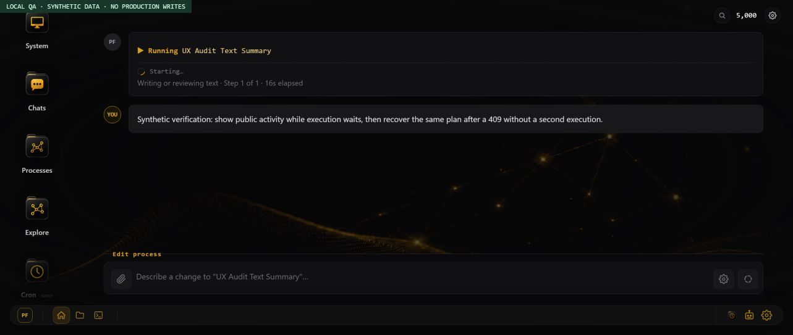

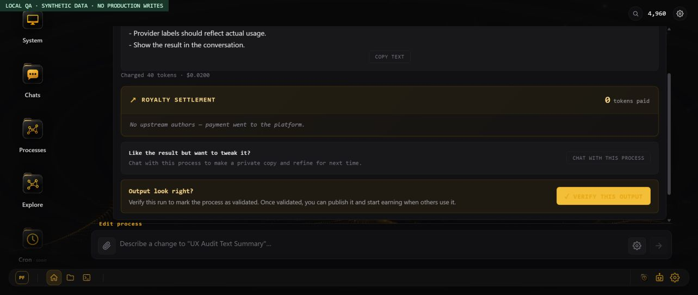

## Successful verification after deployment — November 11, 2026

The user deployed the follow-up fixes. Cloudflare reports backend version `76f39bf8-dfe5-4f16-ab68-94e7d4892426` serving 100% of traffic, deployed at **11:34:52 AM Eastern**. The live frontend contains the execution-stream client, activity observer, and executable-graph input inference. Reloading Chrome retained the signed-in account and showed the correct starting balance, 158,925. The earlier run remained recorded as running on its second image and was not modified.

A fresh run of the same private **Research-to-Visual Lesson Pack** completed successfully through all six steps. Live activity showed text drafting at step 2, OpenAI generation at steps 3 and 4, and text review at step 5. The client moved from the execution response to status polling while continuing to display activity, and ultimately rendered **Completed** with the final document. No manual duplicate run or retry was started during that execution.

- [Completed lesson document](https://missinglink.build/api/promptflow/documents/d25ce0d0-b3af-4b-620b914a.html): learning objectives, explanations, two embedded figures, a worked redesign example, three quiz questions, answers and five source entries.
- [Overview diagram](https://missinglink.build/api/promptflow/image/a41926e4-517c-4cdb-a496-f486482635d5.png): readable labels and arrows for sunlight, heat storage, reflection, water vapor and shade.
- [Before/after illustration](https://missinglink.build/api/promptflow/image/eb524a68-a9da-4ae5-b777-b5ee4feb4b9e.png): a distinct school redesign with cool/green roofs, trees and light paving. Both actual 1024×1024 images were opened and visually inspected.
- Completion receipt: **60 tokens / $0.0300**. Final visible balance: **158,865**. Total test spend including the earlier incomplete run: **120 of 5,000 authorized PromptFlow tokens**. External API usage remains excluded from this estimate.

The live execution path passes this end-to-end test. This does not certify every feature, provider, CLI paid execution, or recovery of the earlier stranded job. Figure numbering, raw Markdown source links, duplicate elapsed counters, stale running copy, and the PDF action label are recorded above as PF-054–057. The process remains private and was not published or marked marketplace-validated. A later optional D1 cross-check was denied by Cloudflare authorization; the final result and balance above are verified from the live UI and opened output artifacts.

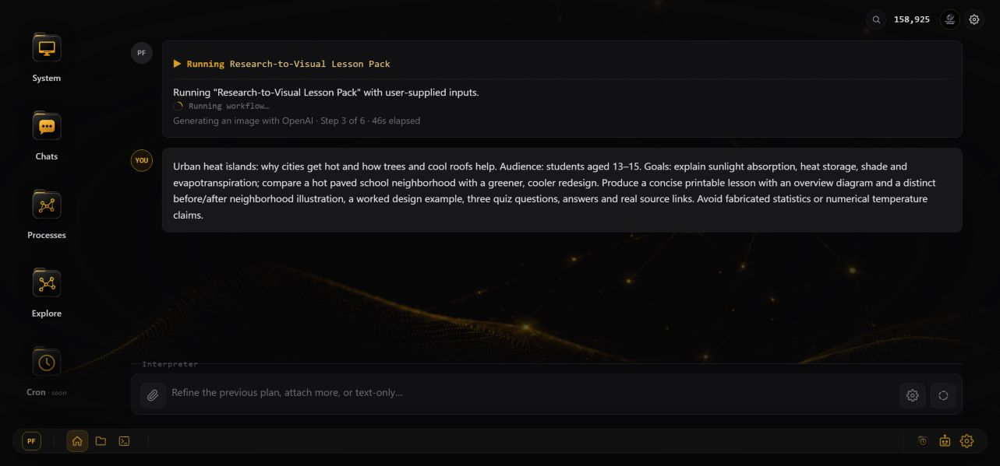

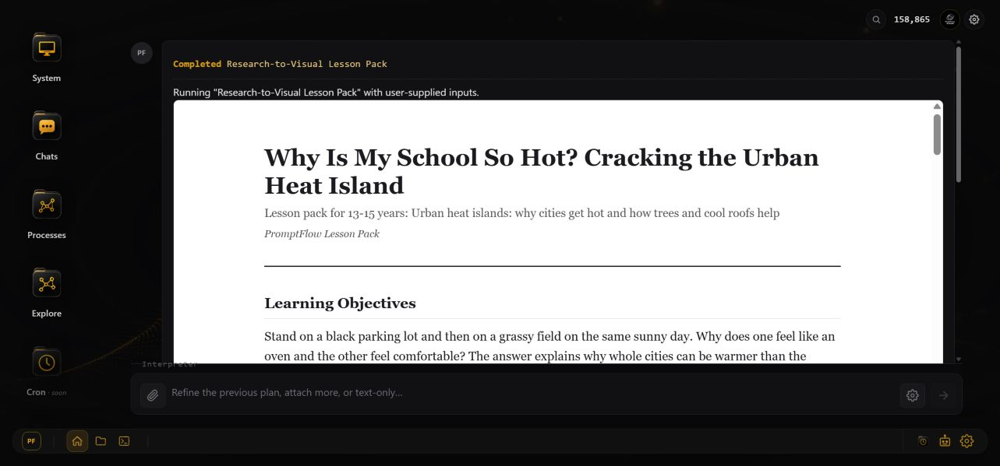

## Adaptive runs, nested execution and cost controls — November 11, 2026

**Local release candidate; not deployed.** This follow-up addresses the user's failed **Web-Sourced Labeled Set → Tuned Search Policy** run. Read-only inspection of the actual signed-in workflow confirmed collection planning, image search, product curation, a loop doing search and AI labeling per product, dataset formatting, and a nested search-policy tuner. The nested `report_document` error came from dispatching composed recipes through a path that rejected non-HTTP steps as fal. No new paid production run or production process edit was made in this follow-up.

Run instructions and input data are now separate. A request such as “run it but generate five synthetic product records first” can plan text/search/media preparation followed by the exact selected workflow. Preparation steps are shown in a named review before execution. Synthetic records must be identified as synthetic; web-sourced evidence must retain source information. The UI shows public preparation/execution stages, selected text models, and the quote. A direct run with supplied inputs skips planning and its planning charge. Nested processes are expanded before quoting and executing; document assembly no longer takes the fal path. Typed inputs, repeated child calls, loop aggregates and queued-step scopes are preserved.

The model panel now applies saved choices to Generate, Chat/run preparation, Adapt, Search, Learn, and workflow text steps. A per-run override takes precedence over saved text-step models; otherwise saved models retain precedence over the account default. Economy selects Haiku for Chat/Search/workflow text, Sonnet for Generate/Adapt/Learn, 8,192 planning output tokens, 2,048 per AI step and five items per loop. Balanced uses 16,000/4,096 and twenty loop items. Exceeding a loop limit fails before that loop processes items, rather than dropping data. Output truncation fails explicitly before downstream steps use incomplete JSON.

The compute-credit limit is checked during review and again before debit, using the stricter positive run/account limit. This is **not a total provider-dollar budget**: external APIs and creator royalties remain separate, and current text-step credits use a flat price independent of model. Loop quotes still price one iteration and disclose that limitation. Lower output limits and smaller loops constrain work but do not provide a cumulative provider-cost ceiling. A model-aware usage ledger and cumulative work/spend budget remain high-priority recommendations under PF-034/061. Hosted BYOK is explicitly unavailable; local CLI runs use provider credentials directly. The generic preferences path no longer returns or accepts keys; historical plaintext copies still need remediation.

CLI **0.3.0** adds `--instructions`, `--name`, a text-model override and output limits. For downloaded workflows it plans preparation, saves a reviewable plan and asks before executing preparation and the workflow; the initial planning call itself incurs provider usage. Hosted runs accept a compute-credit cap. The CLI ZIP and backend-embedded runtime were rebuilt from the maintained source. [Updated installation and examples](../promptflow-cli/README.md).

Verification:

- **31 backend tests passed**: nested document regression, typed inputs and nested loops, namespace isolation, serialized media references, model routing without shared-binding mutation, cost caps, unused-planner pricing, truncation handling, stream behavior and exports. The installed CLI executed an exported archive with an isolated account configuration.
- **19 frontend tests passed**, including named reviews, cost labels, generation/execution streaming, execution recovery and editor input handling.
- **16 Python tests passed**, including synthetic input preparation, search → image preparation, unknown-tool rejection, provider-model/output-limit selection and downloaded execution behavior.
- CLI 0.3.0 installed in an isolated Python 3.9 environment; Wrangler deployment dry-run passed. Provider contract tests use controlled responses, not paid provider calls.
- Chrome localhost checks used visibly marked synthetic data: empty text plus preparation instructions, named review, explicit confirmation, completion, direct chat run instructions, model preset/save/reload, loop-limit persistence and review → Edit process. The latter exposed PF-062 and was retested after repair. A 10-credit cap rejected the fixture's 40-credit quote without executing; retry restored the selected workflow, name, instructions and cap. Raising the cap to 100 led to explicit review, confirmation and Completed. This exposed and verified PF-063. These UI fixtures do not prove live AI planning quality or production nested-provider execution.

Deploy backend first, then `promptflow.html` and the rebuilt `promptflow-cli.zip`. Retry the named live workflow as a fresh reviewed run after deployment. Do not replay or relabel earlier failed/stalled records as successful. Agents and Cron remain intentionally deferred.

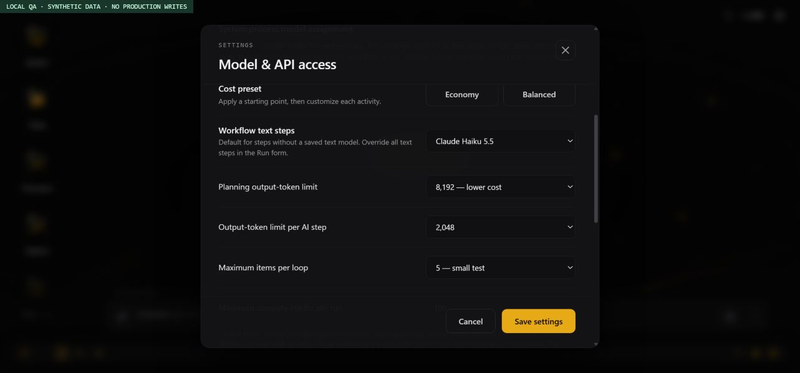

## Interpreter intent follow-up — November 11, 2026

**Local changes; not deployed in this follow-up.** The user's signed-in Chrome conversation showed the failed **Web-Sourced Labeled Set → Tuned Search Policy** run, followed by `genreate`, a `brave_image_search` recipe labelled LTX-2.3 image→video, video fields, and an image-input error. The visible balance was 158,865. Inspection was read-only; no production message, edit or paid run was submitted.

The interpreter now uses conservative action routing instead of treating an open editor as an instruction to modify it:

| Message | Result |
| --- | --- |
| “Why did this fail?” / “Can this generate synthetic inputs?” | Read-only discussion with the accessible workflow's actual steps and recent conversation context. |
| “genreate” / “I want you to generate this” / “make it better” | Focused clarification; no planner/provider call, edit, or execution. A selected workflow offers **Set up a run**. |
| “Can you add a source-check step?” | Explicit refinement for an editable selected process. Read-only processes are discussed rather than silently copied or edited. |
| “Run it but generate five synthetic input records first” | Prepare a plan for the selected workflow, then wait for review/confirmation. |
| “Build a new workflow for summarizing invoices” | New-process creation. |

Unknown messages about a selected process default to discussion. The composer remains labelled **Interpreter** and explains the available actions. Discussion is a read-only endpoint with authorized process/conversation lookup, a bounded recent-message history, the configured Chat model/output limit, cancellation/timeout, and terminal-event handling. An existing conversation alone no longer activates refinement context, and a planner-proposed saved-process mutation is rejected unless the message is an explicit edit request. Refinement progress is labelled **Updating your process** rather than building a new process.

The planner no longer chooses the first catalog recipe/model when a target is missing. Single built-in searches/images/documents use executable tool steps and omit unrelated fal model fields. Legacy history retains recorded failures and amounts, while its built-in-tool preview suppresses irrelevant video controls. This does not repair or replay an old failed job.

Validation: **23 frontend tests and 33 backend tests passed**, including the installed CLI archive regression. Wrangler deployment dry-run passed. Chrome verified the exact typo in a new chat and loaded history, retained workflow context, a question without refinement, an explicit edit, and a run command reaching a confirmation screen. Synthetic server logs showed discussion → edit → plan only for the corresponding explicit requests. No paid-provider semantic evaluation or live post-deploy run was performed. These are conservative routing rules; unfamiliar wording can still ask for clarification instead of acting.

Deploy the backend and `promptflow.html` together (backend first). No CLI runtime change was required for this browser-routing follow-up.

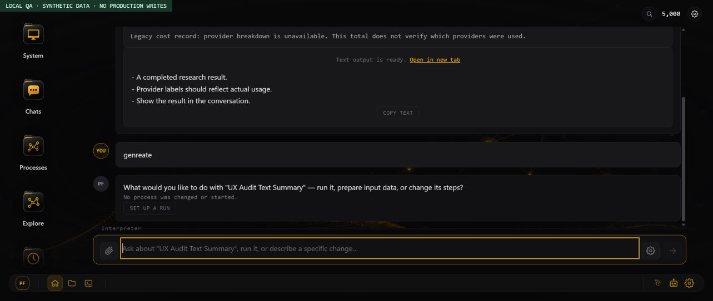

[Observed live fallback before the fix](qa/promptflow-ambiguous-generate-live.png)

## Run preparation, conversation titles and responsiveness follow-up — November 11

**Local changes, not deployed.** The live Chrome page showed the exact request “use a process with some test data and show me it running” stuck at Planning. Its console recorded the old busy watchdog recovery while the spinner remained. Inspection was read-only and did not reload or replay that production request.

Forced runs now bypass the generic authoring prompt, classifier and conversation retrieval. A narrow sample-data command creates an executable AI input-generation step followed by the exact selected workflow, with no planning-model call. The generation step receives the workflow’s bounded input contract/first steps so it prepares the input the workflow actually consumes (for example a research brief), rather than its final deliverable. Other preparation requests use a separate bounded planner with available text/search/media tools. Its output is validated, then the server appends the selected process. Questions return directly without another discussion call; no setup path can save a workflow edit.

“Use a process with some test data and show me it running” now selects a visible, runnable process and prepares a reviewable run. This uses the configured Chat model for selection/setup and the configured Run model for execution; sample input generation happens only after confirmation. Quotes and the existing credit cap remain in force. Complex requests can still need clarification or fail on an unavailable provider; the changes do not promise arbitrary unsupported tools or guarantee live provider success.

Both normal and streamed browser planning have deadlines. The watchdog aborts its own pending request rather than unlocking the composer while leaving a spinner and late response active. The provider stream ends on message_stop, reports error/interrupted streams, and input-preparation provider calls share a two-minute deadline. Public progress names the current activity without exposing private reasoning. Retry restores the original instruction.

Conversation titles reuse task names without an extra model call. They occupy existing top-gutter space without shifting messages, composer or controls, also update the browser tab, and restore from saved history. Existing/manual titles remain authoritative. Questions and draft-only sessions have a local title until the application creates a persisted conversation; retroactive renaming of old chats is not included.

The desktop hero SVG is hidden by the current design, so it now starts no background animation. Graph dragging uses stage-owned pointer capture instead of accumulating global mouse listeners. Dock/tooltip blur and broad control transitions were reduced. These remove confirmed unnecessary work; representative-device performance profiling remains a recommendation, not a measured speedup claim.

Validation: **27 frontend + 46 backend tests**, including the installed CLI bundle regression. Chrome exercised delegated sample preparation, selected-workflow “generate the test data”, review → simulated execution → output, history naming, Home title clearing, and stalled planning → visible timeout → request restoration. The local preview calls the actual deterministic preparation/compiler helpers; process selection and provider execution remain controlled fixtures. No production credits were spent. Backend Wrangler deployment dry-run passed.

Deploy the backend (including `promptflow_run_preparation.ts` and the runtime stream fix), then the frontend `promptflow.html`, and hard-refresh the browser. No CLI rebuild is required for this follow-up. Verify one bounded production run after deployment before treating the live failure as resolved.

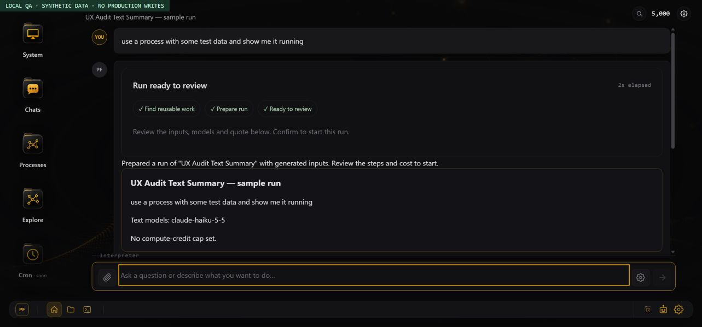

## Learn More bundle guide — November 11, 2026

**Local documentation changes, not deployed.** The [Learn More page](../promptflow_learn_more.html) now shows the actual exported file tree, explains editable prompts and manifest references, separates optional metadata from runtime files, and covers nested processes and custom recipes. The invalid YAML showcase is replaced by a small executable manifest and its prompt. Downloads are described as snapshots rather than a guarantee of identical model results.

The guide includes direct Python execution, source-ZIP CLI installation for Windows and macOS/Linux, required provider variables, preflight checks, input preparation, run names, model/output controls, extraction/editing, and troubleshooting. It distinguishes local provider billing from hosted PromptFlow credits and explains the limits of preflight and spending controls. Private-process retrieval wording now matches owner-scoped selection. The in-app help links to this guide and the legacy interpreter hero no longer advertises a single-script installation or hosted billing for local execution.

Validation: the displayed JSON and prompt were packaged with the maintained runtime; direct archive, installed CLI and extracted-folder `--check` commands passed without provider calls. Page anchors, duplicate IDs and the download target were checked. **27 frontend tests passed.** Chrome verified the file guide, section navigation and expandable installation instructions at desktop and mobile widths. The mobile title overflow was fixed; the page has no horizontal overflow at the tested 390-pixel viewport, while long commands scroll within their own boxes. These checks do not constitute paid provider execution or a production deployment.

Deploy `promptflow_learn_more.html` and `promptflow.html` with the existing `promptflow-cli.zip` asset. This documentation follow-up does not require a backend deployment or CLI rebuild.

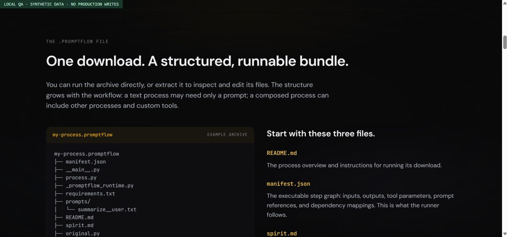

[Mobile installation instructions](qa/promptflow-learn-more-mobile.png)

## Marketplace, mark usage and mobile follow-up — November 11, 2026

| ID | Priority | Observed issue / request | Resolution | Verification |
|---|---|---|---|---|
| PF-071 | P1 | No first-party Marketplace with durable individual access; subscription-only downloads do not cover token purchases. | Seven priced workflows, generated covers, matching folder icon, server-checked ownership, atomic one-time token purchase and included subscriber access. Run fees are separate and quoted. | SQL-backed purchase/access/rollback/retry tests; local browser confirmation and owned state. No real token purchase made. |
| PF-072 | P1 | An uploaded photo cannot be consumed by the generation-only OpenAI image recipe. | Both hosted and Python runtimes support image edits. First Marketplace workflow sends photo plus the user's guide, exports the guide and instructions, opens an image upload form and displays output. | Seven bundles execute with provider fixtures; image-edit payload checks source + guide; local upload → review → confirm → fixture image + download link. Real conversion quality still needs provider verification. |
| PF-073 | P2 | Learn More command card shows a bright horizontal scrollbar and cuts off instructions. | Code preserves newlines but soft-wraps long commands and tokens. | No overflowing visible code blocks at desktop and 390px width. |
| PF-074 | P2 | Language identity is subordinate to the OS tagline, weakening association between PromptFlow™ and offered software. | Lead with the programming-language definition; branded software download, real example program and online software links; consistent ™ and recorded-owner attribution. | Official application 97913988 checked in TSDR; Classes 009/042 and standard-character mark verified. Local page is not a filing specimen. |
| PF-075 | P1 | Short/mobile home view clips the PromptFlow™ wordmark above the viewport. At 664×532 the heading top was about -3px while the stream began at 48px. | Safe vertical centering falls back to top alignment when the hero is too tall. Smallest wordmark size reduced to fit. | At the same size, heading begins around 75px; also visible at 390×844 with no horizontal page overflow. |
| PF-076 | P2 | Mobile output verification squeezes its explanatory text into a narrow column next to a fixed-width button. | Stack the text and action on screens up to 600px. | Responsive completion view checked with a local provider fixture. |

Full implementation, prices, deployment inventory and remaining limitations: [Marketplace notes](promptflow-marketplace.md). Trademark-specific capture guidance and verified record: [statement-of-use notes](promptflow-statement-of-use-notes.md). All changes are local until deployed. CLI download rebuilt as 0.3.1; agents and cron remain unchanged.

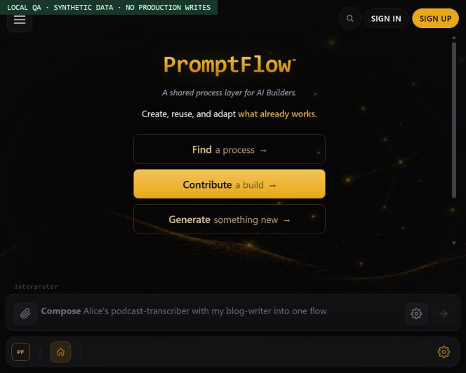

## Production deployment and Marketplace launcher — November 12, 2026

| ID | Priority | Observed issue | Resolution | Verification |
|---|---|---|---|---|
| PF-077 | P1 | The Marketplace commit was pushed, but GitHub Pages remained `building` from November 11 at 22:46 UTC without an Actions run. Production served the preceding commit and returned 404 for the new script. | Requested a fresh Pages build for `bd2eacc`. Corrected deployment notes: the frontend uses GitHub Pages, while Wrangler deploys the backend. | [Pages deployment succeeded](https://github.com/PotentiallyARobot/MissingLink/actions/runs/43260300441). Live sidebar, seven covers, subscriber access and download-start confirmation verified; mobile wordmark top was 75px at 664×532. |
| PF-078 | P1 | “Upload image & prepare run” failed with an HTML/JSON parsing error. Marketplace called `GET /process/get?id=…`, while production accepts POST. The preview incorrectly accepted both. | Reuse the existing editor's POST loader, then open the loaded process's input collector. Keep Marketplace open on failure and prevent a stale process from running. Preview now rejects GET, missing IDs and unauthenticated requests. | 29 frontend tests pass, including the actual launcher + editor loader with the production HTTP contract, HTML/404/401 failure handling and the busy guard. Live upload/review verification follows deployment. |

## Recommended next work

1. **Money and trust:** reconcile historical charges and retries; implement actual usage/charge/refund records; unify entitlement copy and cost confirmation. Acceptance: a text/search run has no fal usage or fal charge, and its receipt matches the token ledger.
2. **Credentials and settings:** deploy and verify model routing/settings merges, implement encrypted hosted provider-key storage and BYOK billing, migrate existing plaintext copies, and clarify Save/Cancel behavior. Acceptance: no plaintext keys in localStorage or generic settings; one settings panel cannot erase another's values.
3. **Execution staging:** add deterministic provider stubs and test create → run → successful output → reload, failure/refund, retry, stop, nested processes, loops, uploads, export/import, and commit/publish permission gates. Verify modified frontend and backend together before release.
4. **Discovery and authoring:** unify public/private semantics, correct old metadata, paginate conversations, improve composition relevance, and validate draft metadata and server cancellation across real authoring sessions. The local editor now prioritizes running with optional technical details.
5. **Accessibility and launch readiness:** complete keyboard/dialog/screen-reader and mobile checks; implement scheduler/agent backends before enabling submission; test timezone and recurring-cost expectations.


## Cost, privacy and navigation follow-up — November 12, 2026

| ID | Priority | Issue | Fix / status |
|---|---|---|---|
| PF-079 | P1 | OpenAI image runs unnecessarily uploaded through fal and failed with invalid fal credentials. | Upload only for actual fal steps, including nested ones. Real OpenAI panorama run completed. |
| PF-080 | P1 | Paid OpenAI image steps showed a zero quote. | Calculate image output by size/quality plus input allowances; show OpenAI separately; block an increased stale quote before charging. Provider costs remain estimated. |
| PF-081 | P1 | Personal uploads and generated results were served without account checks. | Authenticated owner checks, no-store headers, owner metadata, historical run lookup; direct provider image data and expiring non-image media capabilities. Anonymous and cross-account tests cover GET/HEAD, expiry and tampering. R2 public endpoints disabled. |
| PF-082 | P2 | Processes/Explore navigation and hover were choppy; late folder requests could paint the wrong view. | Removed full-panel blur and hover movement, defer offscreen card rendering, skip hidden duplicate list, batch search per frame, reject stale responses. No numerical FPS improvement claimed. |
| PF-083 | P1 | One image edit prompt cannot guarantee equirectangular geometry or consistent directional views. | User confirmed square 180° mono. Detailed geometry-first workflow specified in promptflow-panorama-workflow.md; current conversion remains approximate pending implementation and visual validation. |

Validation: 43 backend pricing/runtime/privacy tests and 32 frontend UX tests passed; Worker build passed. The pricing reference is https://developers.openai.com/api/docs/guides/image-generation (checked 2026-11-12). Broader measured billing, loop reconciliation, and provider retention controls remain recommendations.


Live verification: the historical panorama report opens for its owner; fresh anonymous GET requests to both report and image return 404 with private/no-store headers. Artifact reads bypass schema seeding, reducing the observed anonymous authorization response from about 9 seconds to 0.3–0.4 seconds. Processes shows 74 items with no duplicate hidden-list cards, no panel blur, and working filtering/list mode. A fresh panorama quote shows 362 tokens with an OpenAI line item.

Remaining presentation recommendation: the review card hides the internal value-binding step (showing two steps) while execution counts all three; align visible step numbering and replace the stale “Preparing run” heading as soon as execution starts.

Final bounded live test: “Private panorama verification” completed; quoted/charged 362 tokens and the displayed balance fell by exactly 362. Its newly generated image and report loaded in the authenticated UI; fresh anonymous GET and HEAD requests to both returned 404/private/no-store. No real Marketplace unlock purchase was performed.
